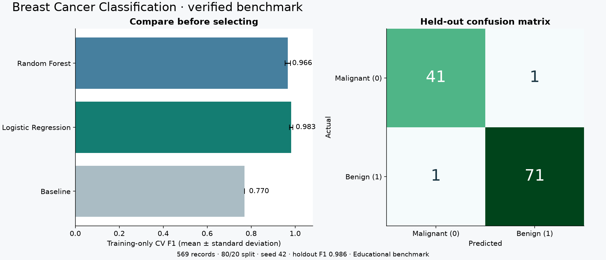

# Breast Cancer Classification Pipeline

A reproducible **educational binary classification benchmark** comparing a majority-class baseline, Logistic Regression, and Random Forest. It uses the breast cancer dataset bundled with scikit-learn, so the default run works offline. This benchmark is not a clinical diagnostic tool.

## Project preview

[Open the public interactive demo](https://jakkrapat-project-lab.happy-bud-2264.chatgpt.site/#ml)



Explore the recorded CV results and replay six held-out benchmark records in the browser using exported Logistic Regression parameters. Browser probabilities are checked against saved Python outputs. Full model training remains in the Python pipeline.

## Run locally

Python 3.11+ (PowerShell):

```powershell
python -m venv .venv
.\.venv\Scripts\python.exe -m pip install -e ".[dev]"
.\.venv\Scripts\python.exe -m ml_pipeline.train --output artifacts
```

Or run `ml-train --csv data.csv --target outcome --output artifacts` after activating the environment. A custom CSV must have numeric features, at least 30 rows, a complete 0/1 target, and at least 10 records in each class. Missing feature values are imputed; infinity and entirely missing columns are rejected.

## Experiment workflow

1. Validate the dataset and create a stratified 80/20 train/test split (seed 42).
2. Fit median imputation and scaling **inside each training fold** using sklearn Pipeline.
3. Compare three models with training-only stratified five-fold cross-validation.
4. Choose the model with highest mean CV F1, refit on training rows, then evaluate it once on the untouched test split.
5. Save the fitted preprocessing/model pipeline, metrics, model comparison, and holdout predictions.

The report includes CV F1 mean/std, CV ROC AUC, holdout accuracy/F1/ROC AUC/confusion matrix, dataset fingerprint, feature names, seed, Python/sklearn versions, and actual execution timestamp. For the bundled dataset, class 0 is malignant and class 1 is benign; F1 treats **class 1** as positive. Metric interpretation must reflect that choice.

| Artifact | Purpose |
|---|---|
| model.joblib | Fitted preprocessing and selected estimator |
| metrics.json | Evaluation and reproducibility metadata |
| comparison.csv | CV results for every candidate |
| holdout_predictions.csv | Actual labels, predictions, and probability of class 1 |

Load only a trusted model file, with compatible dependency versions:

```python
import joblib
from ml_pipeline.data import load_data

model = joblib.load("artifacts/model.joblib")
x, _ = load_data()
print(model.predict(x.iloc[:3]))
```

## Verify

```powershell
.\.venv\Scripts\python.exe -m pytest -q
.\.venv\Scripts\ruff.exe check .
.\.venv\Scripts\ruff.exe format --check .
```

Tests cover deterministic metrics, artifact reload, fitted imputer statistics, duplicate headers, and invalid custom CSVs. Repeatability applies to the same data and dependency versions; execution timestamps intentionally differ.

## Limits

A small public benchmark cannot establish real-world clinical performance. There is no hyperparameter search, deployment, calibration study, external validation, or causal claim. Preserve the holdout split when extending experiments. Do not select models using holdout scores.

[sklearn Pipeline reference](https://scikit-learn.org/stable/modules/compose.html). Study notes: [docs/learning.md](docs/learning.md).

## Optional GitHub Actions CI

[docs/ci.yml](docs/ci.yml) contains a ready-to-use workflow for Python 3.11–3.13. It is a template, not an active workflow. To enable it, copy it to `.github/workflows/ci.yml` using a GitHub credential with workflow write permission. The current publishing credential lacks that permission; local checks were run successfully.
