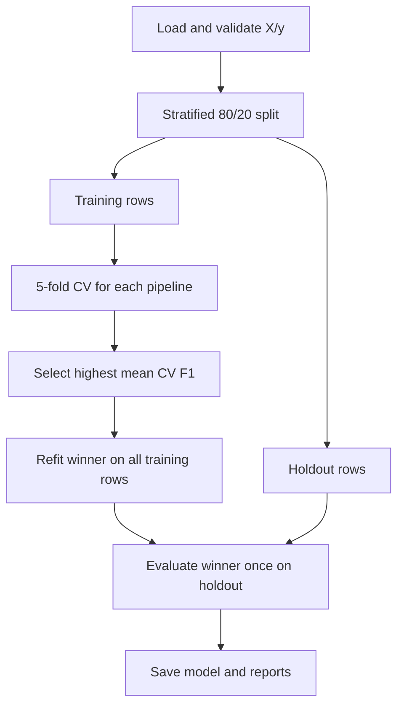

# Breast Cancer Classification Pipeline — เรียน Machine Learning ตั้งแต่ศูนย์

คู่มือนี้อธิบาย repo `breast-cancer-classification-pipeline` ด้วย workflow ที่รันได้จริง โฟลเดอร์ในเครื่องปัจจุบันชื่อ `machine-learning-pipeline` เริ่มจากแนวคิด input/คำตอบ ไปจนถึงการเปรียบเทียบโมเดลและโหลดโมเดลที่บันทึกไว้

ข้อมูล breast cancer ในโปรเจกต์เป็น **benchmark เพื่อการศึกษา** จาก scikit-learn ไม่ใช่ระบบวินิจฉัยทางคลินิก คะแนนดีบน benchmark ไม่ยืนยันว่าพร้อมใช้กับคนไข้จริง

## 1. ระบบนี้ทำอะไร

ระบบรับข้อมูลตารางที่มี features เป็นตัวเลขและ target เป็น 0/1 แล้ว:

1. ตรวจข้อมูลและแบ่ง train/test
2. เปรียบเทียบ baseline, Logistic Regression และ Random Forest ด้วย cross-validation บน train
3. เลือกโมเดลจาก CV F1 แล้วฝึกอีกครั้งบน training rows ทั้งหมด
4. ประเมินโมเดลที่เลือกบน held-out test set และบันทึกผลพร้อม model artifact


สิ่งที่ควรทำได้หลังเรียน: อธิบายว่าโมเดลเรียนจากอะไร เปรียบเทียบอย่างยุติธรรมอย่างไร อ่าน confusion matrix ได้ และใช้ model เดิมทำนายโดยไม่ฝึกซ้ำได้

## 2. คำศัพท์ก่อนเริ่ม: ML ไม่ใช่การเขียน if ทุกกรณี

**Supervised learning** ใช้ตัวอย่างที่มีทั้ง input และคำตอบเพื่อเรียนความสัมพันธ์ เช่น feature 30 ค่า → label 0 หรือ 1 แทนที่จะเขียนเงื่อนไขด้วยมือทุกแถว

| คำ | ความหมายในโปรเจกต์ |
|---|---|
| Sample / record | ข้อมูลหนึ่งแถว |
| Feature / X | คอลัมน์ตัวเลขที่ป้อนให้โมเดล |
| Target / label / y | คำตอบ 0 หรือ 1 ที่ใช้สอนและตรวจ |
| Classification | ทำนายหมวดหมู่ ไม่ใช่ตัวเลขต่อเนื่องแบบ regression |
| Model | ฟังก์ชันที่เรียนพารามิเตอร์จากตัวอย่าง |
| Training | กระบวนการเรียนพารามิเตอร์ด้วย `fit()` |
| Inference | ใช้ model ที่ฝึกแล้วกับ input ด้วย `predict()` |
| Overfitting | เรียนรายละเอียดของชุดฝึกมากเกินจนใช้กับข้อมูลใหม่ไม่ดี |
| Generalization | ความสามารถในการใช้กับข้อมูลที่ไม่เคยเห็น |
| Artifact | ไฟล์ผลจากการทดลอง เช่น model และ metrics |

Pandas DataFrame คือข้อมูลตาราง `X.shape` บอกจำนวนแถว/feature ส่วน Series ของ y เป็นคำตอบหนึ่งค่าต่อแถว ชื่อ “target” ไม่ได้บอกว่าคลาสใดสำคัญกว่า เราต้องรู้ mapping ของ dataset ด้วย

สำหรับคนเริ่ม Python: `import` นำ library มาใช้ `def train(...)` ประกาศ function ที่รับ input และคืน report ส่วน `candidates` เป็น dict จับคู่ชื่อกับ model object การวน `for name, estimator in candidates.items()` จึงทดลองทีละโมเดล และ `if __name__ == "__main__"` ทำให้เรียก CLI เมื่อรัน module โดยตรง

## 3. What / Why / How ของการทดลอง

| What | Why | How ในโค้ดนี้ |
|---|---|---|
| Baseline | มีจุดอ้างอิงก่อนเพิ่มความซับซ้อน | DummyClassifier ใช้ class prior |
| Train/test split | กันข้อมูลที่ไม่ใช้เลือกโมเดล | stratified 80/20 split |
| Cross-validation | ประเมินหลายส่วนของ training set | StratifiedKFold 5 folds |
| Preprocessing ใน Pipeline | ป้องกันข้อมูล validation ช่วย fit ขั้นแปลง | imputer → scaler → model ในทุก fold |
| Selection metric | ต้องกำหนดกติกาเลือกให้ชัด | ค่าเฉลี่ย training-only CV F1 สูงสุด |
| Holdout evaluation | วัดผลขั้นสุดท้ายบนข้อมูลกันไว้ | evaluate เฉพาะโมเดลที่เลือกแล้ว |
| Reproducibility metadata | รู้ว่าได้ผลนี้จากเงื่อนไขไหน | seed, fingerprint, versions และ timestamp |

## 4. เครื่องมือและแผนที่ source

| เครื่องมือ/ไฟล์ | หน้าที่ |
|---|---|
| Python | ลำดับการทดลองและ CLI |
| Pandas / NumPy | ตาราง ชนิดข้อมูล missing และ infinity |
| scikit-learn | dataset, preprocessing, estimator, CV และ metrics |
| joblib | บันทึก/โหลด fitted pipeline |
| argparse | แปลง argument จาก terminal เช่น `--seed` |
| hashlib | สร้าง fingerprint ของข้อมูล |
| pytest / Ruff | ตรวจพฤติกรรมและรูปแบบโค้ด |
| Git / GitHub | เก็บ source; artifact ที่สร้างใหม่ไม่ถูก commit โดยอัตโนมัติ |
| `src/ml_pipeline/data.py` | โหลดและ validate ข้อมูล |
| `src/ml_pipeline/train.py` | `build_pipeline()`, `train()` และ `main()` |
| `examples/metrics.json` | รายงานตัวอย่างจากการรันจริง |
| `tests/test_training.py` | deterministic metrics, reload model และ invalid input |

Matplotlib ใช้ทำภาพกราฟประกอบใน workspace และ Sites ใช้เผยแพร่ browser preview ทั้งสองไม่ใช่ส่วนที่ `ml_pipeline.train` ต้องเรียกเพื่อฝึกโมเดล

## 5. Step by step: รันการทดลองครั้งแรก

### ขั้นที่ 1 — เข้า repo และติดตั้ง

จาก `ProfileProject`:

```powershell
Set-Location .\machine-learning-pipeline
python --version
python -m venv .venv
.\.venv\Scripts\python.exe -m pip install -e ".[dev]"
```

ใช้ Python 3.11+ ถ้า clone repo ชื่อใหม่ โฟลเดอร์จะชื่อ `breast-cancer-classification-pipeline` `.venv` แยก library ของโปรเจกต์ `-e` ติดตั้ง source แบบ editable ส่วน `[dev]` เพิ่ม pytest/Ruff

ในเครื่องนี้มี environment ร่วมที่ `ProfileProject/.venv` แล้ว ถ้าใช้ตัวนั้น ให้เปลี่ยน `.\.venv\Scripts\python.exe` เป็น `..\.venv\Scripts\python.exe` หลังเข้า repo และข้ามขั้นสร้าง/ติดตั้ง environment ใหม่

### ขั้นที่ 2 — ฝึกด้วยข้อมูลที่มีมากับ library

```powershell
.\.venv\Scripts\python.exe -m ml_pipeline.train --output artifacts
```

หลังติดตั้ง library แล้ว default dataset ไม่ต้องดาวน์โหลดเพิ่ม terminal จะแสดง selected model และ holdout metrics รุ่นที่บันทึกไว้เลือก `logistic_regression` ไฟล์ถูกเขียนใน `artifacts`

### ขั้นที่ 3 — เปิดผลที่สร้าง

```powershell
Get-Content .\artifacts\metrics.json
Import-Csv .\artifacts\comparison.csv | Format-Table
Import-Csv .\artifacts\holdout_predictions.csv | Select-Object -First 5
```

| ไฟล์ | อ่านเพื่ออะไร |
|---|---|
| `model.joblib` | ใช้โมเดลและ preprocessing ที่ fit แล้ว |
| `metrics.json` | dataset, seed, versions, CV และ holdout metrics |
| `comparison.csv` | เปรียบเทียบโมเดลด้วย CV ตามกติกา |
| `holdout_predictions.csv` | ดู actual/prediction/probability ทีละ test row |

ไฟล์ `.joblib` ไม่ใช่ข้อความ เปิดด้วย Get-Content แล้วจะอ่านไม่เข้าใจ ต้องโหลดผ่าน joblib ดังตัวอย่างในขั้นต่อไป

## 6. Step by step: กระบวนการเรียนรู้ภายใน



### 6.1 Dataset และ validation

ค่าเริ่มต้นโหลด `load_breast_cancer(as_frame=True)` มี 569 แถวและ 30 features ตัวเลข เช่น mean radius, mean texture และ mean area พร้อม target:

- `0` = malignant
- `1` = benign

เมื่อใช้ CSV ของตนเอง ต้องมีอย่างน้อย 30 แถว มี feature อย่างน้อยหนึ่งคอลัมน์ และ target 0/1 ที่ไม่หาย ต้องมีอย่างน้อย 10 แถวต่อ class เพื่อทำ stratified evaluation ได้ ชื่อคอลัมน์ซ้ำและ feature ที่ไม่ใช่ numeric, มี infinity หรือหายทั้งคอลัมน์จะถูกปฏิเสธ

missing feature บางแถวอนุญาตเพราะมี imputer แต่ **missing target ไม่เติม** เพราะไม่มีคำตอบที่น่าเชื่อถือสำหรับฝึก

### 6.2 แยก test ออกก่อน

`train_test_split(..., test_size=0.2, stratify=y, random_state=42)` แบ่ง dataset ตัวอย่างเป็น train 455 แถวและ test 114 แถว `stratify=y` ช่วยให้สัดส่วน class ใกล้เคียงเดิม ไม่ใช่ทำให้สอง class มีจำนวนเท่ากัน

**Test set ไม่ใช่สนามเลือกโมเดล** ถ้าเห็น test score แล้วเปลี่ยนโมเดลไปเรื่อย ๆ เรากำลังปรับให้เข้ากับข้อสอบ แม้ไม่ได้เรียก `fit()` บน test โดยตรง ผลประเมินก็เริ่มมีอคติ

### 6.3 ทำ 5-fold CV ภายใน train

แบ่ง training rows เป็นห้าส่วน รอบหนึ่งใช้สี่ส่วนฝึกและอีกส่วนตรวจ ทำครบห้ารอบจนแต่ละส่วนได้เป็น validation fold แล้วเฉลี่ยคะแนน

ทุก candidate ใช้ splitter แบบเดียวกันเพื่อให้เปรียบเทียบยุติธรรม ค่า `cv_f1_std` คือความแปรปรวนระหว่าง folds ไม่ใช่ความเชื่อมั่นของ prediction แต่ละคน และไม่ใช่การพิสูจน์ผลกับข้อมูลภายนอก

### 6.4 Fit preprocessing ใหม่ในแต่ละ fold

```python
Pipeline([
    ("imputer", SimpleImputer(strategy="median")),
    ("scaler", StandardScaler()),
    ("model", estimator),
])
```

Median imputer เติมช่องว่างด้วย median ที่เรียนจากส่วนฝึก ส่วน StandardScaler เรียน mean/std เพื่อปรับสเกล Pipeline ทำให้ `cross_validate()` fit ทุกขั้นจาก training fold แล้วใช้ค่าชุดนั้นแปลง validation fold

ถ้า fit scaler บนข้อมูลทั้งชุดก่อน CV ส่วน validation จะมีอิทธิพลต่อ mean/std ที่ใช้ฝึก นั่นคือ leakage โค้ดจึงส่ง pipeline ทั้งชุดให้ CV แทนการส่งเฉพาะ estimator

### 6.5 เปรียบเทียบสามโมเดล

| โมเดล | หลักการ | เหตุผลที่นำมาเปรียบเทียบ |
|---|---|---|
| DummyClassifier(strategy="prior") | ใช้สัดส่วน class ของชุดฝึก; prediction เป็น majority class | เช็กว่าความซับซ้อนเพิ่มคุณค่าหรือไม่ |
| Logistic Regression | เรียน linear score แล้วแปลงผ่าน sigmoid เป็นความน่าจะเป็น | baseline ที่เรียน feature จริง อธิบาย coefficient ได้ |
| Random Forest | รวมผล decision trees หลายต้น | จับ nonlinear relationships ได้ |

แม้ชื่อ Logistic **Regression** แต่ตัวนี้ใช้ทำ **classification** โค้ดตั้ง `max_iter=2000` เป็นเพดานการหา solution ไม่ใช่จำนวน epochs ที่เราต้องทำเอง ส่วน Random Forest ใช้ 100 trees และ `min_samples_leaf=2` เพื่อไม่ให้ leaf เล็กเกินไป

Scaler สำคัญสำหรับ Logistic Regression ที่มี regularization แต่ tree ไม่จำเป็นต้อง scale เพื่อจัดลำดับ split โค้ดใช้ preprocessing ร่วมเพื่อให้ workflow เรียบง่าย ไม่ใช่เพราะทุก model ต้องการ scaling เท่ากัน

### 6.6 เลือกและฝึก final model

`max(comparisons, key=...cv_f1_mean)` เลือกค่าเฉลี่ย F1 สูงสุด จากนั้นสร้าง pipeline ของตัวชนะและ fit บน training rows ทั้งหมด โมเดลนี้ยังไม่ใช้ test rows เพื่อเรียนพารามิเตอร์

โค้ดเปรียบเทียบโมเดลที่ตั้งค่าไว้สามตัว ยังไม่มี hyperparameter search หากเพิ่ม GridSearchCV ให้ทำภายใน train และคง test ไว้ประเมินท้ายสุด

## 7. Metrics: อ่านจาก confusion matrix ก่อนจำสูตร

สำหรับรายงานปัจจุบัน positive class คือ **1 = benign** ถ้าเปลี่ยนงานหรือสนใจ class 0 ต้องกำหนด metric ใหม่ ไม่ควรตีความ F1 เดิมเป็นประสิทธิภาพการตรวจ malignant โดยตรง

ผล holdout ที่บันทึกไว้:

| Actual \ Predicted | 0: malignant | 1: benign |
|---|---:|---:|
| 0: malignant | 41 | 1 |
| 1: benign | 1 | 71 |

เมื่อ class 1 เป็น positive จะได้ TP = 71, TN = 41, FP = 1 และ FN = 1:

- **Accuracy:** `(TP + TN) / ทุกแถว` = `112 / 114` ≈ 0.9825 บอกสัดส่วน prediction ที่ตรง label
- **Precision:** `TP / (TP + FP)` = `71 / 72` บอกในสิ่งที่ทาย positive มีกี่ส่วนที่เป็นจริง
- **Recall:** `TP / (TP + FN)` = `71 / 72` บอกจับ positive จริงได้กี่ส่วน
- **F1:** `2 × precision × recall / (precision + recall)` ≈ 0.9861 ผสม precision/recall
- **ROC AUC:** วัดการจัดอันดับคะแนน positive เทียบ negative ข้าม thresholds ผลตัวอย่างประมาณ 0.9954 ไม่ใช่ accuracy ที่ threshold เดียว

F1 = 0.986 **ไม่ควรเขียนว่า accuracy 98.6%** เพราะ accuracy ของ run นี้เป็นประมาณ 98.25% คนละ metric และไม่มี metric ตัวเดียวที่แทนทุกความเสี่ยงของงานจริง

CV F1 ที่บันทึกไว้: baseline ≈ 0.7703, Logistic Regression ≈ 0.9825, Random Forest ≈ 0.9665 ส่วน holdout F1 ≈ 0.9861 เป็นผลของโมเดลที่เลือกแล้ว ไม่ใช่คะแนนที่ใช้เลือก

## 8. โหลด model แล้วทำนายโดยไม่ฝึกใหม่

รันจาก root ของ repo หลังมี `artifacts/model.joblib`:

```powershell
@'
import joblib
from ml_pipeline.data import load_data

model = joblib.load("artifacts/model.joblib")
x, _ = load_data()
print(model.predict(x.iloc[:3]))
print(model.predict_proba(x.iloc[:3])[:, 1])
'@ | .\.venv\Scripts\python.exe -
```

นี่สอนการ reload pipeline ไม่ใช่ประเมินใหม่ ตัวอย่างสามแถวจาก dataset อาจเป็น training rows จึงห้ามนำความถูกต้องของสามแถวนี้ไปอ้างเป็นผล holdout

`predict_proba()` คืนความน่าจะเป็นตามลำดับ class `[0,1]` ดังนั้น `[:,1]` คือ P(benign) ส่วน `predict()` คืน label ใช้ pipeline ทั้งชุดทำให้ imputation/scaling ใช้ค่าที่ fit ไว้แล้ว

โหลดเฉพาะ artifact ที่เชื่อถือและรู้ที่มา เพราะ joblib ใช้รูปแบบ serialization ที่สามารถรันโค้ดขณะโหลดได้ การเก็บ model ต้องรักษา dependency compatibility ด้วย ไม่ใช่เอาไฟล์ไปเปิดด้วยทุก sklearn version ได้เสมอ

## 9. ฝึกด้วย CSV สำหรับทดลองเอง

สร้างข้อมูลสังเคราะห์เพื่อเรียนวิธีรับ CSV เท่านั้น ไม่ใช่ข้อมูลผู้ป่วย:

```powershell
@'
import csv
with open("practice.csv", "w", newline="", encoding="utf-8") as handle:
    writer = csv.writer(handle)
    writer.writerow(["feature_a", "feature_b", "target"])
    for i in range(60):
        writer.writerow([i, i % 5, int(i >= 30)])
'@ | .\.venv\Scripts\python.exe -

.\.venv\Scripts\python.exe -m ml_pipeline.train --csv practice.csv --target target --output artifacts/practice
```

อ่าน `metrics.json` ชุดใหม่และสังเกตว่า features กับจำนวนแถวเปลี่ยน อย่าเอาคะแนนของโจทย์สังเคราะห์นี้มาเปรียบเทียบตรง ๆ กับ breast cancer benchmark เพราะเป็นคนละข้อมูลและความยาก

## 10. ทำให้การทดลองตรวจย้อนหลังได้

Report บันทึก seed, จำนวน train/test, feature names, Python/sklearn versions, เวลา UTC และ dataset fingerprint ซึ่งสร้างจากตารางที่โหลดแล้วรวม index **ไม่ได้ hash bytes ของไฟล์ CSV ตรง ๆ** จึงเป็นหลักฐานเพื่อเทียบข้อมูลใน workflow นี้ ไม่ใช่ universal fingerprint ที่รับประกันข้ามทุก library version

Seed ช่วยให้ randomness เหมือนเดิม แต่ต้องใช้ข้อมูลและ environment เดิมด้วย `created_at` จะเปลี่ยนตามการรันจริง แม้ metric เท่ากัน และความทำซ้ำได้ไม่ใช่หลักฐานว่าโมเดล generalize ไปทุกประชากร

[เว็บสาธารณะ](https://jakkrapat-project-lab.happy-bud-2264.chatgpt.site/#ml) แสดงรายงานที่บันทึกไว้ และ replay หก held-out rows ด้วย Logistic Regression parameters ที่ export แล้ว ตรวจเทียบกับ Python outputs ได้ ส่วน training และ model comparison เต็มยังอยู่ใน CLI Python

## 11. Tests และ troubleshooting

```powershell
.\.venv\Scripts\python.exe -m pytest -q
.\.venv\Scripts\ruff.exe check .
.\.venv\Scripts\ruff.exe format --check .
```

มี 8 test cases ในเวอร์ชันที่บันทึกไว้ `test_training_artifacts_and_deterministic_metrics` ฝึกสองครั้งแล้วตรวจ metric และ fingerprint พร้อม reload model ส่วน `test_preprocessing_fits_training_data_only` ตรวจ fitted median ไม่เปลี่ยนตอน predict

| ปัญหา | ตรวจอะไร |
|---|---|
| feature เป็นข้อความ | CSV นี้รองรับ numeric features; ต้องออกแบบ encoding ก่อนใช้ข้อมูล categorical |
| target มี class เดียว | ต้องมีทั้ง 0/1 และอย่างน้อย 10 แถวต่อ class |
| คะแนนดีผิดปกติ | ตรวจ target leakage, duplicate samples และวิธี split |
| model โหลดไม่ได้ | ตรวจ path และ dependency versions ที่ report บันทึกไว้ |
| ฝึกซ้ำได้ผลต่าง | เทียบ seed, input, versions และการเปลี่ยนโค้ด |

Tests ปัจจุบันไม่ได้พิสูจน์ว่า dataset ภายนอกไม่มี leakage ทางธุรกิจ ต้องตรวจความหมาย feature และหน่วยของ sample เอง

## 12. แบบฝึกหัดและคำถามตรวจความเข้าใจ

1. วาด train/CV/test เป็นสามวงและบอกว่าแต่ละส่วนใช้ทำอะไร
2. เปิด confusion matrix แล้วคำนวณ accuracy ด้วยมือ → `112/114`
3. เปลี่ยน seed และดูความแปรปรวน → บันทึกทุก run ไม่เลือก seed ที่ test score สวยที่สุด
4. เพิ่ม estimator อีกตัวใน `candidates` → ให้เข้า pipeline และ CV เดิม
5. ทำ feature engineering → transformation ที่เรียนจากข้อมูลต้อง fit ภายใน fold
6. ออกแบบ metric ให้ class 0 เป็น positive → ต้องเปลี่ยน scoring ให้ถูกและอธิบาย mapping ใหม่

- ทำไมไม่เลือกจาก test accuracy? **เพราะ test ใช้ประเมินผลสุดท้าย ถ้าใช้เลือกก็ไม่เป็นข้อมูลกันไว้จริงแล้ว**
- ทำไม baseline F1 ไม่เป็นศูนย์? **ทาย majority class ซึ่งตรง positive class ได้หลายแถว แม้ไม่ใช้ feature**
- ทำไมเลือก Logistic Regression ทั้งที่ Random Forest ซับซ้อนกว่า? **กติกาดู mean CV F1 ไม่ใช่ชื่อหรือความซับซ้อน**
- อะไรต้องใช้ตอน inference? **feature schema เดิมและ fitted preprocessing/model ไม่ใช่ fit scaler ใหม่จาก input ที่เข้ามา**

ถือว่าเข้าใจเมื่อคุณรันเอง อ่าน report อธิบายการเลือกโมเดลและ metric ตาม positive class ได้ แล้วแก้ candidate หรือ CSV input อย่างมีเหตุผลได้

## 13. เอกสารอ่านต่อ

- [sklearn Pipeline และ composite estimators](https://scikit-learn.org/stable/modules/compose.html)
- [sklearn Linear Models รวม Logistic Regression](https://scikit-learn.org/stable/modules/linear_model.html)
- [sklearn Model evaluation](https://scikit-learn.org/stable/modules/model_evaluation.html)
- [README ของโปรเจกต์](../README.md)
